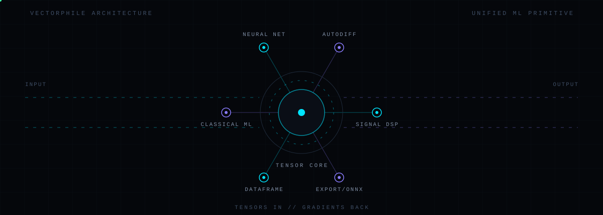

<!-- ==============================================================
     IDENTITY MODULE v8.0 — SAAD SALMAN
     deep learning systems / llm inference / open source
     ============================================================== -->

&nbsp;&nbsp;

<picture>
  <source media="(prefers-color-scheme: dark)"  srcset="https://raw.githubusercontent.com/SaadxSalman/saadxsalman/output/github-contribution-grid-snake-dark.svg"/>
  <source media="(prefers-color-scheme: light)" srcset="https://raw.githubusercontent.com/SaadxSalman/saadxsalman/output/github-contribution-grid-snake.svg"/>
  
</picture>

> Good infrastructure outlives its authors. What I build gets upstreamed — in
> public, under permissive licenses, with the docs that make it reusable.
> PRs welcome.

---

<!-- SIGNALS — uncomment and fill in your handles to activate

&nbsp;

&nbsp;

-->

